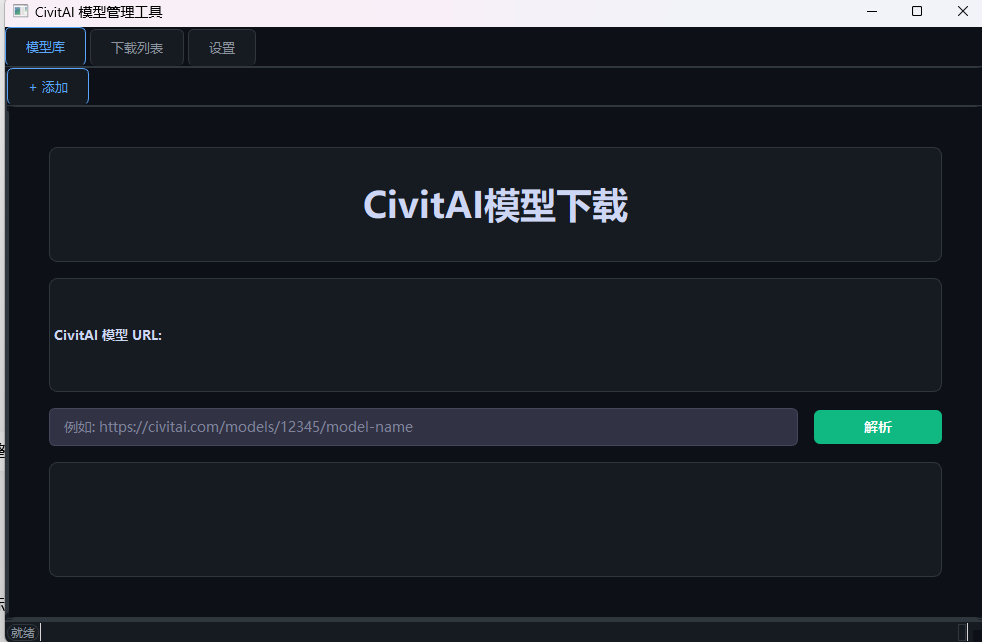

# CivitAI 模型下载工具（CivitAIdown）

面向 ComfyUI / Stable Diffusion 用户的 Windows 桌面下载工具，用于从 CivitAI 获取模型信息并下载模型，支持断点续传、暂停 / 继续、本地模型库浏览与资料导出。

## 功能概览

- **模型信息获取**：粘贴 CivitAI URL，自动拉取模型详情、版本、文件列表、示例图片
- **快速下载**：粘贴 URL 直接进入文件选择与下载流程
- **多文件下载**：版本内多文件勾选下载，独立进度、断点续传、暂停 / 继续 / 取消 / 重试
- **下载列表操作**：行内按钮 + 右键菜单控制暂停、继续、取消、重试，按任务状态自动启用 / 禁用
- **本地模型库**：扫描 ComfyUI 目录，关联 CivitAI 元数据，缩略图浏览
- **HTML 资料页**：单文件 base64 模式 / 文件夹模式双模式导出
- **Markdown 导出**：一键导出模型资料为 Markdown 文件
- **元数据兼容**：生成的 `metadata.json` 兼容 ComfyUI-Lora-Manager 1.1.9

## 快速开始

1. 前往 [Releases](https://github.com/ooUwUoo/CivitAIdown/releases) 下载最新的 `CivitAIManager_Portable.zip`
2. 解压到任意目录（路径无需含中文以外的特殊字符）
3. 运行解压目录中的 `CivitAIManager.exe`
4. 首次使用时在向导或设置中填写你的 CivitAI API Key

## 使用说明

- **添加下载**：粘贴 CivitAI 模型链接，选择版本与需要的文件后开始下载
- **任务控制**：在下载列表中通过行内按钮或右键菜单进行暂停、继续、取消、重试；按钮会根据任务状态自动可用或置灰
- **断点续传**：网络中断、暂停或程序意外退出后，再次启动可从已有进度继续下载，不会从头开始
- **API Key**：保存在系统凭据库中，同一台机器无需重复填写；更换电脑需要重新填写
- **首启向导**：若系统中已保存过 Key，会自动回填并跳过向导；否则首次启动会提示填写 Key

## 便携版约定

- **免安装**：解压后直接运行 EXE，无需安装程序
- **可移动**：整个文件夹可以复制到任意位置运行
- **数据隔离**：用户数据保存在 EXE 同级目录，不写系统目录
- **完整卸载**：删除整个文件夹即可

## 目录与数据

- `data/`：配置、缩略图缓存与本地数据库，首次运行自动创建
- `downloads/`：默认下载目录，首次运行自动创建
- `logs/`：运行日志，首次运行自动创建

## 许可证

本软件基于 [PolyForm Noncommercial License 1.0.0](https://polyformproject.org/licenses/noncommercial/1.0.0) 发布，版权所有 © 2026 ooUwUoo。

- 允许：个人学习、研究、测试、业余爱好等非商业用途的使用、修改
- 禁止：任何商业用途，以及售卖本软件、源码或其衍生作品（包括转售安装包、付费分发、捆绑商用产品）
- 商业使用或销售许可须另行获得版权所有人的书面授权

完整条款见 [LICENSE](LICENSE) 文件。软件按"现状"提供，不附带任何担保。
